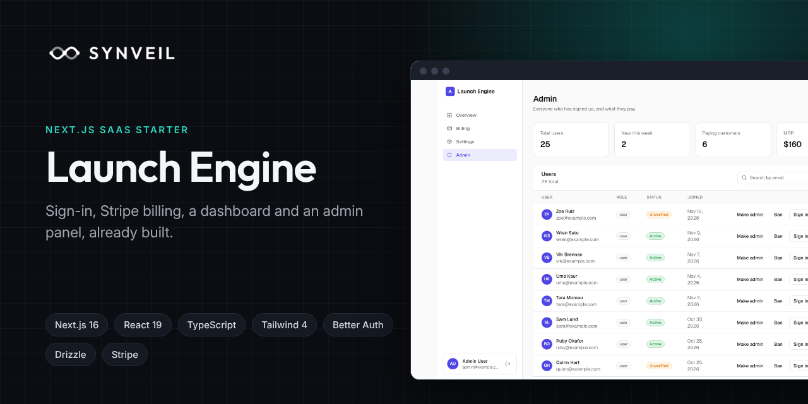
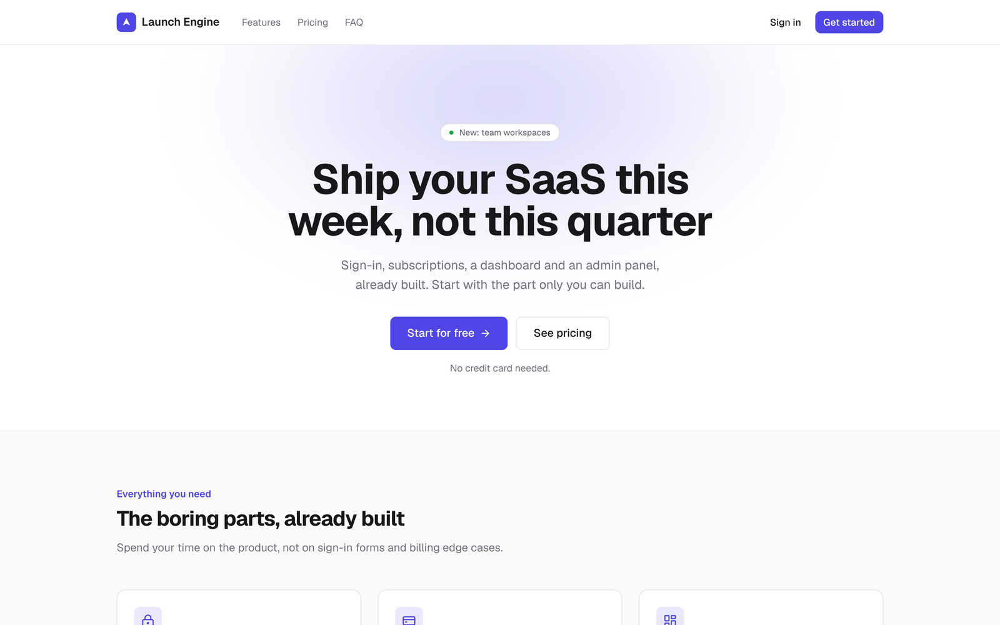
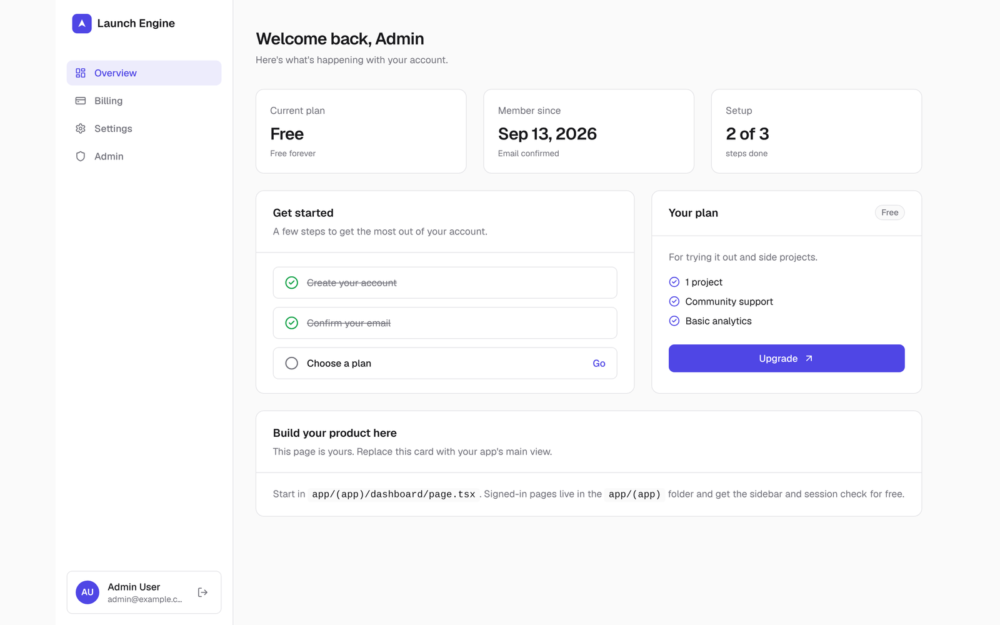
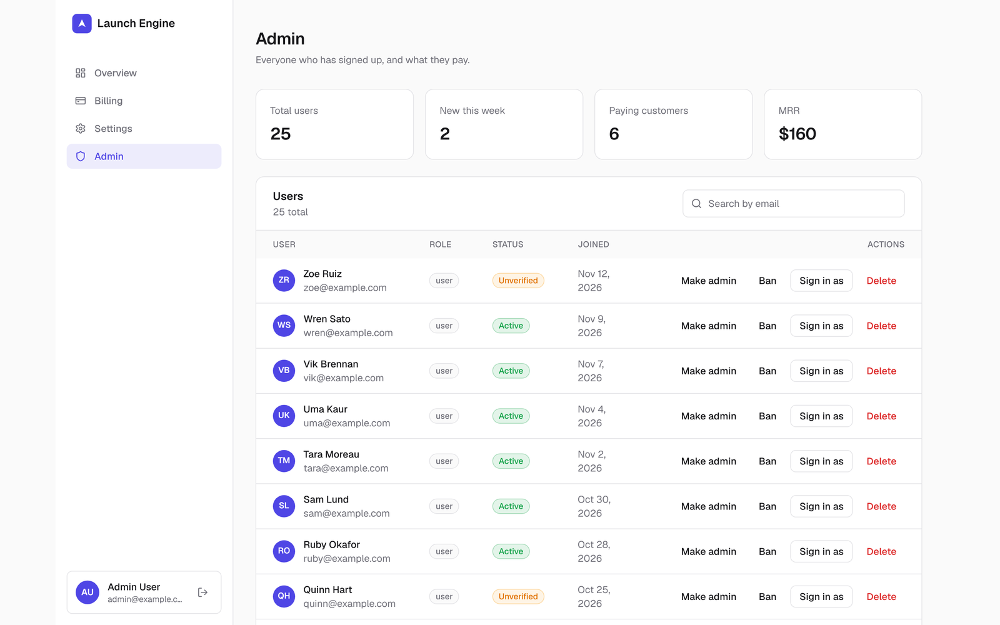
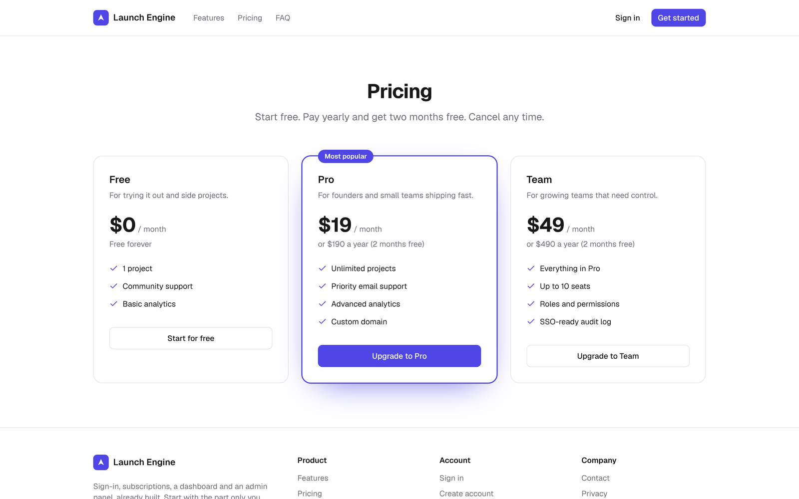
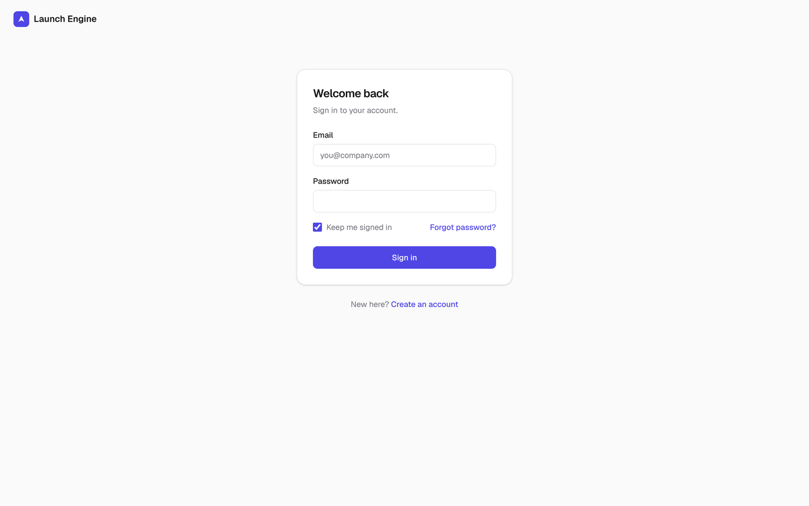

# Launch Engine

**Next.js SaaS starter with sign-in, billing and admin already built.** Start with the part only you can build.

**$349, one-time** · [**Buy on Whop →**](https://whop.com/synveil/launch-engine/) · [All Synveil kits](https://synveil.whop.site/)

> This repo is the public page for Launch Engine. The source code is delivered as a download when you buy. It isn't in this repo.

## What's inside

- **Next.js 16 app** in TypeScript, with React 19 and Tailwind CSS 4
- **Sign-in:** email and password with confirmation and password reset, plus Google and GitHub (Better Auth)
- **Billing:** Stripe Checkout, customer portal and webhook sync for subscriptions
- **App:** user dashboard, billing page and account settings
- **Admin panel:** stats, MRR, user search, roles, ban, sign in as a user, delete
- **Email:** five transactional templates with React Email and Resend
- **Database:** Drizzle ORM and Postgres, with migrations and a demo seed script
- **Pages:** landing, pricing, terms and privacy
- **Docs:** seven guides covering setup, auth, billing, email, admin, customizing and deployment

A clean install from the download lints, typechecks and builds, and the end-to-end test run passed 29 of 29.

## Screenshots

These are taken from the app itself, running with its demo seed data.

| Landing page | User dashboard |
|---|---|
|  |  |
| **Admin panel** | **Pricing** |
|  |  |

Sign-in page

## Stack

| Area | Built with |
|---|---|
| Framework | Next.js 16 (App Router), React 19, TypeScript |
| Styling | Tailwind CSS 4 |
| Auth | Better Auth (email/password, Google, GitHub, admin plugin) |
| Database | Postgres with Drizzle ORM |
| Payments | Stripe Checkout, customer portal, webhooks |
| Email | Resend and React Email |

## How you get it

1. Buy on [Whop](https://whop.com/synveil/launch-engine/). Access is instant.
2. Download the zip from the Launch Engine page in your Whop account.
3. You need Node.js 20.9 or newer and a Postgres database (a free Neon database works). Run `npm install`, fill in `.env`, run `npm run db:migrate` and `npm run dev`.
4. Follow the guides to connect Stripe, email and social sign-in, then deploy.

## License

One payment covers unlimited products of your own and products you build for clients, and you can change the code however you like. You can't resell or publish the starter itself, or put its source in a public repository. The full license comes in the download.

Also in [Synveil Complete](https://whop.com/synveil/synveil-complete/), the bundle of all five Synveil kits.
